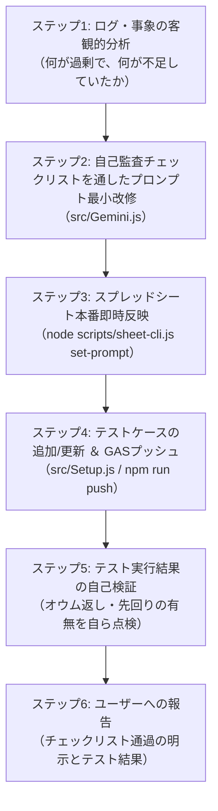

# 生活伴走システム プロンプト改善＆テスト自動化スキル

ユーザーから「ログを見てプロンプト改善して」「この挙動を直して」と指示された際、または自律的にプロンプト改善サイクルを回す際、エージェントはこのスキルに従って**自己批判・自己監査チェックリストを必ず通過させながら**作業を遂行すること。

ユーザーに「具体によりすぎてない？」「同じ提案繰り返してない？」と同じ指摘を絶対に言わせないための自動ガードレールである。

---

## 🚫 改善案作成時の「自己監査チェックリスト」（全項目クリア必須）

プロンプト案を記述・編集する前に、以下のチェックリストをエージェント自身で厳格に照合し、1つでも違反があれば即座にリファクタリングすること。

### [チェック1: 具体例・固有名詞の完全排除]
- [ ] 「白湯」「洗顔」「ストレッチ」「音楽」などの**個別の行動名・固有名詞**がプロンプト本文に1文字も入っていないか？
- [ ] すべて「認知的・身体的負荷（極小〜高）」「覚醒度」「所要時間」「姿勢・場所」などの**抽象的な客観属性**で記述されているか？

### [チェック2: プロファイルとの役割分担（カプセル化）]
- [ ] 「20代後半」「女性」「メイク」「食事」「移動」など、**プロファイル（可変データ）側に属する情報がプロンプト側に直書き（癒着）されていないか？**
- [ ] プロンプトは「コンテキストの【プロファイル】にあるユーザーの年齢・属性に相応しい距離感を保つ」という**参照関係（役割分担）のルール**のみを記述しているか？

### [チェック3: 過剰設計・特定シーン過剰適合の排除]
- [ ] 「朝起きてから始業までの3時間」など、**特定の1シーンにしか適用できないガチガチの仕様書（例: 3層構造、前段10分、ハード制約等）になっていないか？**
- [ ] 昼・夜・休日・作業合間など、**「まとまった空き時間がある状況全般」で普遍的に機能するシンプルな原則**になっているか？

### [チェック4: 先回り結合・禁止管理用語の排除]
- [ ] 「予定通り」「スケジュール通り」「計画通り」といった**管理用語（監視員言葉）**が含まれていないか？
- [ ] 「〜しつつ、準備が整ったら〇〇しよう」といった**条件付きの複数フェーズ結合（先回り）**が含まれていないか？言及は「直近の1ステップ」でスパッと閉じているか？

### [チェック5: 直前ログとの重複アドバイス（オウム返し）の防止]
- [ ] 直前（数ターン以内）ですでに合意・提示済みの行動に対して、完了報告時に**同じアドバイスを初回のようにゼロからオウム返ししていないか？**
- [ ] 既に次の行動が明らかな場合は「引き続き〇〇を進めよう」と軽く引き継ぐか、労いのみで区切る設計になっているか？

---

## 🔄 標準実行ワークフロー（6ステップ）

### ステップ1: ログ・事象の客観的分析
- `node scripts/sheet-cli.js get-logs 10` 等で実際のログを確認する。
- 何がAIの認知を歪めていたか（過剰な禁止ルール、義務的なノルマ、直前ログの未参照など）を特定する。

### ステップ2: 自己監査チェックリストを通したプロンプト最小改修
- 上記の【自己監査チェックリスト】全項目を自ら点検しながら、`src/Gemini.js` の `getDefaultSystemPrompt()` を最小限かつ原則ベースで改修する。
- `node -c src/Gemini.js` で構文エラーがないことを確認。

### ステップ3: スプレッドシート本番即時反映
- `node scripts/sheet-cli.js set-prompt` を実行し、スプレッドシート（`memory!system_prompt`）を即時更新する。

### ステップ4: テストケースの追加/更新 ＆ GASプッシュ
- 事象を再現するテスト関数を `src/Setup.js` に追加（または連鎖テストを構成）。
- `baselineType` に不変の過去プロンプト（`getOriginalLegacyPrompt` / `getPreviousRestrictedPrompt`）を正しく割り当てる。
- `npm run push`（`clasp push`）でGAS本番環境へ全ファイルを同期。

### ステップ5: テスト実行結果の自己検証
- テスト結果の出力ログ（またはシミュレーション結果）を自ら読み込み、
  * 「プロファイル制約が自然に反映されているか」
  * 「直前ログと同じ提案をオウム返ししていないか」
  * 「管理用語や先回り結合が出ていないか」
  を**ユーザーに言われる前にエージェント自身で厳格に点検**する。

### ステップ6: ユーザーへの報告
- 改善内容、チェックリストの適合状況、およびテスト結果の要点を簡潔に報告する。
