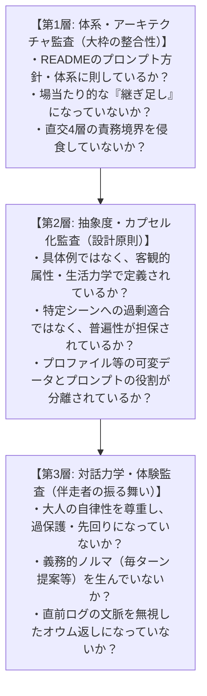
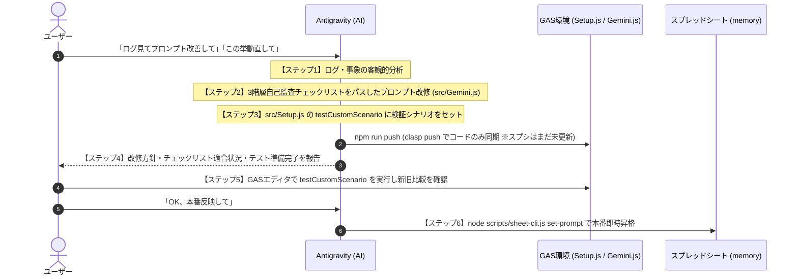

# 生活伴走システム プロンプト改善＆検証支援スキル

生活伴走システムのプロンプト改善を行う際、エージェントは目先の事象に対する対症療法や場当たり的な継ぎ足しを完全に排除し、**READMEのプロンプト方針および直交4層アーキテクチャに則った体系的な改修**を行わなければならない。

本スキルは、エージェントが自らの設計案を大枠から厳格に自己監査し、ユーザーに同じ指摘を繰り返させないためのガバナンスフレームワークである。

---

## 🏛️ プロンプト改善の3階層自己監査チェックリスト（全項目クリア必須）

プロンプト案を記述・編集する前に、エージェントは以下の3階層を上位から順に自ら点検し、1つでも違反があれば即座に設計を見直すこと。

### 1. 【体系・アーキテクチャ監査（大枠の整合性）】
- [ ] **プロンプト体系との整合**: READMEに定めた「直交4層アーキテクチャ（第1層:基本姿勢・境界 → 第2層:リズム基準 → 第3層:意図分類 → 第4層:提案エンジン）」の構造を崩さず、適切な階層に位置づけられているか？
- [ ] **継ぎ足し（パッチワーク）の排除**: 発生した個別事象に対するその場しのぎの例外ルールを末尾や隙間に付け足すのではなく、既存の原則の定義不足や曖昧さを解消する「根本的な構造整理」になっているか？
- [ ] **責務の直交性**: あるセクションのルールが、他のセクションの役割や禁止事項と矛盾・衝突（過剰抑制や意図しない競合）を引き起こしていないか？

### 2. 【抽象度・カプセル化監査（設計原則）】
- [ ] **原則ベース（Principles over Examples）の徹底**: 個別の行動名・固有名詞・固定分数を本文から完全に排除し、すべて「認知的/身体的負荷」「覚醒度」「所要時間」「生活力学」などの客観属性・原則として定義されているか？
- [ ] **普遍性（Generalizability）の担保**: 特定の1シーン（朝の3時間等）に過剰適合したガチガチの仕様書にならず、あらゆる時間帯・あらゆる状況で自然に機能する普遍的なルールになっているか？
- [ ] **データとプロンプトのカプセル化**: プロファイルやカレンダーなどコンテキスト（可変データ）側の実装内容をプロンプト側に直書き（癒着）させず、参照・配慮のルールとして分離されているか？

### 3. 【対話力学・体験監査（伴走者の振る舞い）】
- [ ] **大人の自律性尊重**: 監視員のような管理用語（「予定通り」等）や、小言・条件付き先回りフェーズ結合（「〜しつつ、準備が整ったら〇〇しよう」等）が排除されているか？
- [ ] **義務的ノルマの排除**: 毎ターン必ず提案しなければならないような強迫的ルールを作らず、文脈に応じた軽快さや余白を残しているか？
- [ ] **自然な文脈連鎖**: 直前ログですでに合意・提示済みの内容をオウム返しせず、会話の流れを自然に引き継いでいるか？

---

## 🔄 標準改修＆検証ワークフロー

> **重要（新旧比較の保全）**:
> GASの `runPromptScenario` は **「スプレッドシート現行版（`memory!system_prompt`）」** と **「コード最新候補版（`src/Gemini.js`）」** を比較する。
> したがって、**テスト検証前にスプレッドシート（`memory!system_prompt`）を上書きしてはならない**（上書きすると比較元の現行プロンプトが消えてしまうため）。ユーザーのテスト確認後に本番スプレッドシートへ反映すること。

### ステップ1: ログ・事象の客観的分析
- `node scripts/sheet-cli.js get-logs 10` 等で実際の会話ログを確認する。
- 発生した課題の本質（過剰な制約、義務的ノルマ、文脈の無視など）を客観的に特定する。

### ステップ2: 3階層自己監査チェックリストを通したプロンプト最小改修
- 上記の【自己監査チェックリスト】3階層全項目を自ら点検しながら、`src/Gemini.js` の `getDefaultSystemPrompt()` を原則ベースで最小限に改修する。

### ステップ3: 検証シナリオの設定 ＆ GASプッシュ（テスト関数を増殖させない）
- 個別のテスト関数（`testScene9` 等）を新規追加してファイルを肥大化させてはならない。
- `src/Setup.js` の **`testCustomScenario()`** 内の `scenario` オブジェクト（`turns` 配列で単発・複数ターン連鎖どちらも記述可能）を対象の検証シナリオに書き換える。
- `npm run check` で構文を確認し、`npm run push`（`clasp push`）でGASへ同期する。
- **※この時点ではまだ `node scripts/sheet-cli.js set-prompt` を実行しないこと**（現行本番プロンプトとの新旧比較を可能にするため）。

### ステップ4: ユーザーへのテスト準備報告
- 改修内容、チェックリスト全項目の適合状況、およびGASエディタで `testCustomScenario`（または全体回帰テスト `testAllStandardScenarios`）を実行できる旨を報告する。

### ステップ5〜6: テスト確認後のスプレッドシート本番反映
- ユーザーがGASエディタでテスト結果を確認し承認したら、`node scripts/sheet-cli.js set-prompt` を実行してスプレッドシート（`memory!system_prompt`）へ本番反映する。
