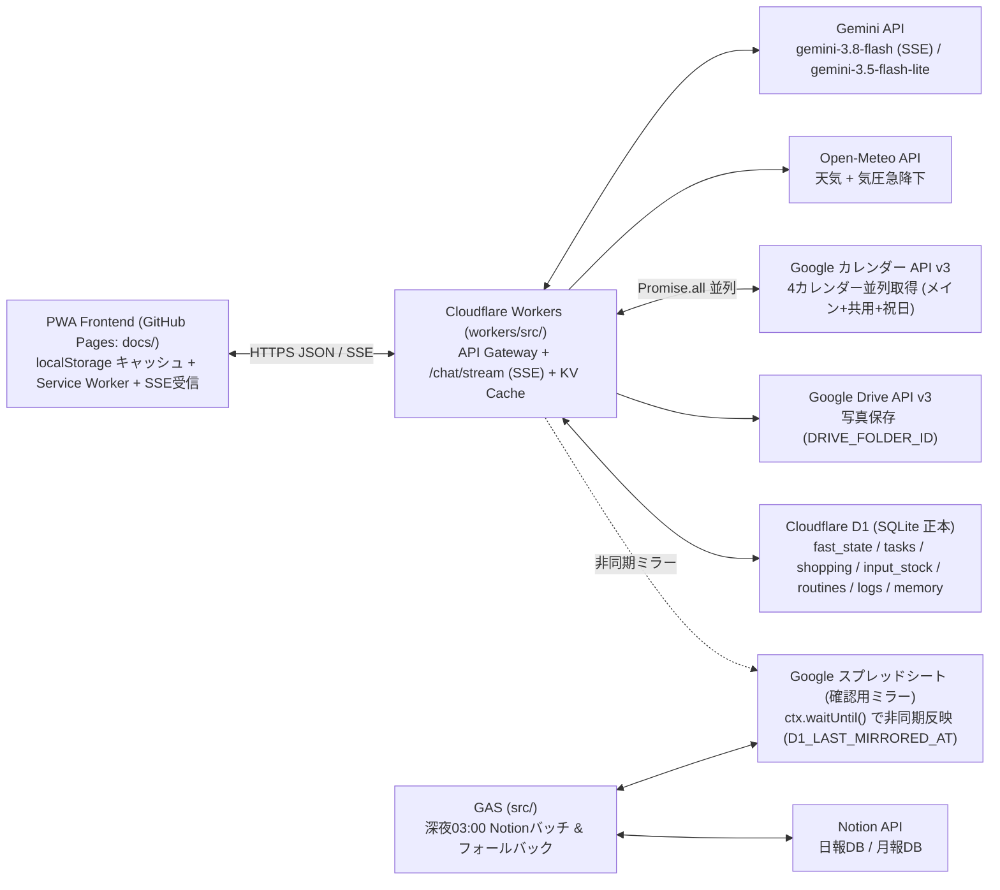

# 📐 Companion Cockpit (Daily Companion v2) — システム全体設計仕様書

> **最終更新**: 2026-11-26 20:02 JST

本仕様書は、[GRAND_DESIGN.md](GRAND_DESIGN.md) の思想に基づき構築する **マイコックピット（Companion Cockpit v2 / 旧称: 生活伴走システム）** の全体像・アーキテクチャ・画面仕様・データモデル・API・AI稼働設計・外部連携・運用仕様を定義する。PWA アプリ名（`manifest.json`）・`<title>`・プロンプト内の自称は **「マイコックピット」**（コックピット計器モチーフのベクターアイコン）に統一する。

---

## 1. システム概要と設計思想

### 1.1 基本コンセプト（役割分離ハイブリッド）
本システムは、単一のチャット画面に全機能を詰め込むのではなく、ユーザーの認知負荷と着手摩擦を極小化するため、用途を以下の3タブに明確に分離する。

| タブ | 役割（思想との対応） | コア体験 |
| :--- | :--- | :--- |
| **Home** | **状況の鏡 × 行動の触媒** | ゼロ入力・1タップで次の行動へ移れるコックピット。現在時刻表示は省き、天気・経過時間（$\Delta t$）・次境界カウントダウンで時間の輪郭を示し、状況に適応した最大3枚の行動カードを提示。タイマー進行〜任意の感想・写真（スキップ可）〜次候補の自動繰り上げを循環させる。 |
| **Chat** | **傾聴・整理・日報の温床** | 気持ちや出来事・DB操作を受け付ける場。写真添付に対応し、DB操作・リスケ／相談・調べ物は必ず返信、それ以外のつぶやき・感想はスタンプ反応をベース（AI判断で適宜短文）として `logs` へ記録する。 |
| **Lists** | **一覧・即実行・編集起点** | `Tasks` / `Shopping` / `Stock` / `Habits` の4リストを確認する場。`Shopping` のみその場で `✓` チェックし、他は `▶` で直接タイマー開始（`docUrl` 連携済みのタスクには資料を開くボタンも併設）。追加・見込み時間変更・リスケ・直接完了修正は下部共通入力バーへのインラインピル挿入＋Chat 送信で行う。 |

- **リクエスト内シート読込キャッシュ（第1段階実装済み）**: `Spreadsheet.js` / `MemoryStore.js` において、1リクエスト内で `getSpreadsheet()` / `getMemory()` / `getTasks()` / `getShoppingList()` / `getInputStockList()` をメモリキャッシュ（`_reqSheetCache`）し、書き込み時（`setMemoryValue` / `apply*Actions`）に該当タブのみ即座に破棄する。
  - **今後の検討事項（第2段階）**: 書き込み後の再読込による遅延がなお気になる場合は、`tasks` タブ等を正規化 JSON ストア（リポジトリパターン）化し、書き込み時にメモリとシートを1か所で同時更新して再読込を完全に省く構成を検討する。

### 1.2 v1（`resilient-noether`）からの継承と v2 設計スタンス

本システムのアーキテクチャは **v1 の延長ではなく、[GRAND_DESIGN.md](GRAND_DESIGN.md) を出発点とした v2 最適設計** とし、v1（`resilient-noether`）からは独立した機能部品（API・データ基盤モジュール）のみを流用する。

- **部品として流用・継承する基盤**（`src/` 配下の既存基盤モジュール）
  - Google スプレッドシート6タブ（`logs`, `tasks`, `routines`, `shopping`, `input_stock`, `memory`）互換スキーマと安全追記・30日ローリング整理
  - Google カレンダー（メイン＋第1家族共用 `♪` ＋第2家族共用＋日本の祝日）読み取りとメインカレンダー操作、`getNextBoundaryInfo` の時間境界算出
  - Open-Meteo API による天気・気温・降水確率・6時間5hPa気圧急降下検知（`Weather.js`）
  - Google Drive 画像保存・共有リンク生成（`lh3.googleusercontent.com/d/<fileId>`）および **Google Docs/Drive プロジェクト連携**
  - Chat の **Web 検索グラウンディング（事実質問前取得）** および `custom_system_prompt`（さっぱりした等身大の敬体）
  - 深夜 `03:00` バッチによる Notion 日報・月報生成、`rolling_memory`/`profile`/`cycle_stamps`/`weekly_summary`/`dictionary` の更新、`routines` 定期タスク自動投入
  - PWA の GitHub Pages 配信（`docs/`）・Service Worker オフラインシェル・CORS 回避通信・縦長スクショ対応クライアント画像圧縮
- **v2 での構造刷新・廃止**
  - **LINE Bot / Webhook の完全廃止**: `LINE_CHANNEL_ACCESS_TOKEN` / `OWNER_USER_ID` / Reply API / LINE 画像バッファリングを廃止し、PWA 専用コックピット＋オーナー認証キー方式へ一本化。
  - **Home / Chat 分離による 0ms 起動・待ち時間ゼロ体験**: 毎回チャットで重い2段階 AI 思考を待つ構成を廃し、事前キャッシュ＋行動開始時/定時再編成により、Home 表示と行動完了遷移の待ち時間をゼロ化。

---

## 2. システム全体アーキテクチャ・通信・認証

### 2.1 コンポーネント構成（現行本番: Cloudflare Workers + D1）

> [!IMPORTANT]
> **現在のリアルタイム API・DB 正本は `workers/`（Cloudflare Workers + D1）** です。GAS（`src/`）は深夜 `03:00` バッチ（Notion 日報・月報・長期記憶代謝）および緊急フォールバック用として稼働しています。



### 2.2 通信方式
- **Cloudflare Workers 接続時（本番標準）**: CORS ヘッダ付き `POST /`（JSON `{ apiAction, args }`）および `POST /chat/stream`（`text/event-stream` SSE リアルタイム配信）でリダイレクトなしに直接通信する。
- **GAS フォールバック接続時**: GAS Web App はプリフライトリクエスト（`OPTIONS`）に応答できないため、`Content-Type: text/plain;charset=utf-8`・`method: 'POST'`・`redirect: 'follow'` の Simple Request を使用する。
- レスポンスは `{ ok: true, data: ... }` または `{ ok: false, error: string }` の JSON（SSE 時は `status` / `delta` / `done` / `error` イベント）とする。

### 2.3 認証と初期セットアップ
- **バックエンド検証**: スクリプトプロパティ `DASHBOARD_ACCESS_KEY`（未設定時は `OWNER_AUTH_SECRET` 等からの SHA-256 先頭16文字、または環境固有ソルト生成キー）とリクエストの `authKey` を照合。不一致時は `{ authorized: false, error: '...' }` を返却して全データ操作を遮断する。
- **クライアント保持**: PWA の `localStorage`（`companion_api_url`, `companion_auth_key`）に保存。初回アクセス時、または認証エラー・URL未設定時は設定モーダル（GAS Web App URL とアクセスキーの入力 UI）を表示する。URL クエリ `?api=...&key=...` からの自動取り込みもサポートする。

### 2.4 リポジトリ・デプロイ・移行構成
- **リポジトリ構成**: 本リポジトリ（`resilient-noether`、`main` ブランチ）に設計ドキュメント・GAS バックエンド（`src/`）・PWA フロントエンド（`web/`, `docs/`）を統合管理する。
- **移行・テスト手順**: 開発・検証中はスクリプトプロパティ `TEST_SPREADSHEET_ID` と `USE_TEST_SPREADSHEET='TRUE'` により検証用コピーシートへ切り替えてテストする。

---

## 3. ストレージ設計とデータモデル

### 3.1 四層のデータ責務

| 保存先 | 保存するデータ | 役割 |
| :--- | :--- | :--- |
| **ブラウザ `localStorage`** | `cc_v2_snapshot`（前回取得した Bootstrap データおよび進行中 `fastState.activeSession` を含むスナップショット一式）、`companion_theme`、`companion_api_url`、`companion_auth_key` | 起動 0ms 仮描画、リロード時の進行中タイマー即復元、楽観的 UI の即時反映 |
| **GAS `PropertiesService`** (`V2_FAST_STATE`) | 進行中セッション、当日非表示、朝ブリーフィング、AI 生成候補デッキ、リスト軽量キャッシュ、状態フラグ | スプレッドシート全走査を避け最速応答する高速ステート |
| **Google スプレッドシート** | `tasks`, `shopping`, `input_stock`, `routines`, `logs`, `memory`（`V2_FAST_STATE` ミラー含む） | 人間が確認・直接編集できる正本（Source of Truth）。`PropertiesService` 消失時の復旧元 |
| **Google Drive** | Chat・Reflection 時に添付された画像ファイル（JPEG/PNG/WebP/GIF） | 公開閲覧リンク（`ANYONE_WITH_LINK` / `VIEW`）を付与し、`https://lh3.googleusercontent.com/d/<fileId>` を `logs` に保存 |

### 3.2 `V2_FAST_STATE` JSON スキーマ

```json
{
  "dayKey": "2026-11-19",
  "activeSession": {
    "id": "T_20261119_001",
    "title": "早希ちゃんにAmazonの件を連絡",
    "icon": "message",
    "mins": 15,
    "startedAt": "2026-11-19T21:10:00+09:00",
    "isSleepCard": false,
    "isWorkBlock": false,
    "isTriage": false,
    "triageTaskIds": [],
    "linkedType": "task",
    "linkedId": "T_20261119_001"
  },
  "completedToday": {
    "c_breakfast": "2026-11-19T07:35:00+09:00"
  },
  "dismissedToday": {
    "T_room": true
  },
  "isLowMode": false,
  "triagedToday": false,
  "lastAction": {
    "title": "夕食",
    "completedAt": "2026-11-19T20:10:00+09:00",
    "isSleep": false
  },
  "dailyBriefing": {
    "dateKey": "2026-11-19",
    "kicker": "今朝のブリーフィング",
    "lines": [
      "気圧は安定 · 予定: 10:00〜19:00 出社",
      "期限: 早希ちゃんにAmazonアカウントの件を相談"
    ],
    "dismissed": false
  },
  "weatherFetchedAt": "2026-11-19T05:00:05+09:00",
  "aiDeck": {
    "generatedAt": "2026-11-19T17:00:00+09:00",
    "cards": [],
    "lowCards": []
  },
  "listCache": {
    "updatedAt": "2026-11-19T20:15:00+09:00",
    "tasks": [],
    "shopping": [],
    "stock": [],
    "habits": []
  }
}
```

- **日次境界（03:00 JST）のルール**:
  - `dayKey` は「03:00〜翌02:59」を同一論理日として扱う（例：11/20 01:30 の `dayKey` は `"2026-11-19"`）。
  - 論理日が変わった際（`03:00` 以降）：`completedToday`, `dismissedToday`, `triagedToday`, `isLowMode` はクリアする。
  - **日跨ぎ「就寝」セッションの保護**: `activeSession && activeSession.isSleepCard === true` の場合、00:00 および 03:00 境界を跨いでも `activeSession` は**絶対にクリアしない**（前日日報は就寝開始時刻までを集計し、翌朝の「起きた」押下で睡眠時間計算・起床ログ記録・セッションクリア・朝ブリーフィング表示へ移行する）。

### 3.3 スプレッドシート互換スキーマ（v1 互換 ＋ v2 後方互換拡張）

1. **`logs`（16列）**
   `[時刻, 発言者, メッセージ, 画像URL, AI返答, Lite入力, Lite出力, Liteキャッシュ, Flash入力, Flash出力, Flashキャッシュ, 新総トークン, 判定タグ/フェーズ, 旧AI返答（比較用）, 旧Flash総トークン, トークン削減差分]`
   - ※Chat で複数/単一画像を添付時は URL を改行区切りで `画像URL` 列へ格納。
   - ※スタンプ反応のみの時は `AI返答` 列に `[スタンプ: 👍]` 等の形式で保存（またはバッジ情報と併せて復元可能にする）。
   - ※v2 で不要な旧比較列等は空欄可。30日超の古いログは深夜バッチで自動削除（Notion 日報成功時のみ）。
2. **`tasks`（10列 ※1〜9列は v1 完全互換、10列目に見込み時間拡張）**
   `[タスクID, タスク名, 期限, ステータス(未完了/完了/破棄), 登録日, 完了日, メモ, リマインド目安, docUrl, 見込み時間(分)]`
   - 完了日時は `yyyy-MM-dd HH:mm:ss` 形式で統一（深夜バッチの 03:00 境界判定に必須）。
   - 見込み時間（10列目）が空欄の既存タスクはデフォルト値（`30` 分）として扱う。Chat 経由の編集時は 10 列目を更新する。
3. **`routines`（7列）**
   `[ルール名, タイプ(day_of_week/day_of_month/interval_days), 設定値, 最終生成日, メモ, ステータス(有効/完了/期間満了), 完了日]`
   - ※深夜バッチで `tasks` へ定期タスクを自動投入する専用シート。日々の生活ルーティン（朝食等）には使わない。
4. **`shopping`（4列）**
   `[品名, カテゴリ, ステータス(未買/購入済/破棄), 登録日]`
5. **`input_stock`（6列 ※1〜5列は v1 完全互換、6列目に見込み時間拡張）**
   `[種別, タイトル, メモ, ステータス(未/完/破棄), 消化日, 見込み時間(分)]`
   - 消化日は `yyyy-MM-dd HH:mm:ss` 形式で記録。見込み時間空欄時は種別ごとのデフォルト値（本: 20分、音楽: 30分、映画: 120分、その他: 30分）を適用。
6. **`memory`（2列）**
   `[キー, 値]`
   - 継承キー: `profile`, `rolling_memory`, `weekly_summary`, `dictionary`, `cycle_stamps`, `weather_info`, `pressure_alert`, `briefing_delivered_date`, `monthly_report_ready`, `ideal_self`, `lifestyle_habits`, `skill_options`, `project_folders`, `backend_model`, `thinking_level` 等
   - v2 追加キー: `V2_FAST_STATE`（`PropertiesService` 状態のシートミラーバックアップ）

---

## 4. 全画面 UI/UX 仕様（PWA フロントエンド）

Sheer Frosted Glass・リアルタイム `<canvas>` Fluid Mist 背景・ライト/ダークモード・フローティングボトムドックを採用したデザインシステムを `web/` 配下に実装する。

### 4.1 共通シェル・ビジュアル仕様
- **PWA 設定**: `manifest.json`（`display: standalone`）、`sw.js`（アプリシェル Precache + Network-First HTML / Stale-While-Revalidate アセット）、iOS 用 `viewport-fit=cover` + `apple-mobile-web-app-status-bar-style: black-translucent`、上端セーフエリア余白 `env(safe-area-inset-top)`。
- **環境同期背景（Fluid Mist）**: 時刻帯（朝 `< 10:30` / 昼 / 夜 `>= 18:30`）および集中状態（`activeSession` 中は速度 0.55 倍・やや落ち着いた表現）に応じて流体ミストのパレットと動きを変化させる。
- **ライト/ダーク切替**: ヘッダまたは設定内に切替トグルを備え、`localStorage` に記憶する。
- **楽観的 UI（Optimistic UI）**: カード開始・完了・スワイプ非表示・Shopping チェック等は UI を即座に更新（トースト表示）して `localStorage` に反映し、バックグラウンドで GAS API と同期する。失敗時はロールバックまたはエラー通知を行う。

### 4.2 Tab 1: Home（状況の鏡 × 行動の触媒）
1. **ヘッダ（状況の鏡）**:
   - メタ行: **アプリ内の現在時刻は省き**、天気・場所サマリー（例：`磯子 晴れ 18℃ · 渋谷 晴れ 19℃` または `気圧急降下注意`）のみ表示。
   - 境界カウントダウン（Hero）: 次の予定・目安（例：`次の予定 · 08:20 出発` / `次の目安 · 23:00 就寝`）と `HH:MM:SS` のリアルタイムカウントダウン（23:00 以降は `そろそろ就寝の時間`）。
   - 直前行動経過行（$\Delta t$）: 前回行動完了からの経過時間（例：`直前: 夕食（25分前）`、`直前: 朝食（完了直後）`、`おはようございます · 起床直後`）。未完了や初回アクセス時は非表示。
2. **朝のブリーフィングカード**:
   - `dailyBriefing` が当日未破棄かつ非進行中の場合に表示。`×` で閉じるか、何か行動を開始した時点で非表示にする。
3. **通常状態（カードデッキ・最大3枚）**:
   - 生活ルーティンテンプレート＋事前キャッシュされた `aiDeck` から最大3枚を表示（引き算カード該当時は最上段に Opal Prism スタイルで強調表示）。
   - **タップ**: 行動開始（Focus 画面へ遷移）。引き算カードタップ時は対象タスクを一括リスケ＋Chat ログへ記録＋トースト通知。
   - **左スワイプ（または「今日は提案しない」ボタン）**: `dismissedToday` に登録し、次候補を繰り上げる。
   - **下部サブアクション**:
     - `自分で始める`: タイトル入力＋**1本の非線形スライダー（`5分 / 10分 / 15分 / 30分 / 45分 / 1時間 / 1.5時間 / 2時間 / 2.5時間 / 3時間 / 4時間 / 6時間`、初期値 `30分`、数値ラベルのみのシンプル表示）**を展開して自由行動でタイマー開始。
     - `別の候補`: 事前キャッシュ済み `aiDeck.cards` をページネーション（オフセット送り）する。すべて見切った（枯渇した）場合はローディング表示の上 `apiRefreshDeck` で新規候補を追加生成する。
     - `少しだるい / 通常に戻す`: 低負荷モード（`isLowMode`）切替。**AI がその時間帯・状況に合わせて事前生成・キャッシュ済みの `aiDeck.lowCards`（3〜5件）へ待ち時間 0ms で切り替える**（未生成時のみコード側フォールバックを使用）。
4. **進行中状態（Focus）**:
   - クリスタルダイヤル内に経過時間（`MM:SS`、1時間超時は `HH:MM:SS` 相当）を表示。
   - **60分経過の優しい通知**: `elapsed >= 60分` かつ業務ブロック・就寝カードでない場合のみ、`そろそろ一息入れませんか` のソフトバッジを表示。
   - **アクション**: `キャンセル`（中断して Home へ戻る。`activeSession` クリア・完了扱いしない） / `終わった`（就寝カード時は `起きた` ラベル、Reflection 画面へ）。
5. **完了・振り返り状態（Reflection）**:
   - 見出し（`お疲れさまでした` / 就寝時は `おはようございます`）＋カード名・実施分数表示（※計測時間の微調整 UI は設けない）。
   - **すべて任意・スキップ可**:
     - 気分チップ（`✨ すっきり`, `😌 ほっとした`, `👍 まあまあ`, `😮‍💨 つかれた`）
     - 写真添付ボタン（カメラ/ライブラリ選択・リサイズ圧縮・サムネイルプレビュー＋`×`削除）
     - ひとこと感想入力欄（※表示時やチップ選択時に**自動フォーカスは絶対に行わない**）
   - **記録・完了の選択**:
     - `linkedType === 'task'` または `'stock'` のカードでは、複数回に分けて取り組む作業・複数話メディア向けに **「今日はここまで（未完のまま記録）」**（`keepOpen: true`: `【進行】` ログと感想・写真を残し、シート上のタスク/ストックは未完了のまま維持）と **「完了にする（やり切った）」**（`keepOpen: false`: シート上も `完了` / `完` へ更新）の2択を表示する。
     - 生活習慣アンカーや単発リラックスカードは従来どおり `つぎへ` で記録し、即座に次の3枚デッキへ戻る。気分・感想・写真の有無にかかわらず Chat 履歴にも `【完了】` / `【進行】` ユーザー発言＋スタンプ反応として残す。

### 4.3 Tab 2: Chat（傾聴・整理・日報の温床）
- **タイムライン**: 当日（03:00境界）の会話・写真（タップでライトボックス拡大）・インライン変数ピル・ユーザー吹き出し下のスタンプ反応チップ（`.reaction-chip`）・AI吹き出し内の実行結果バッジ（`.quiet-badge`）・Google Docs/Drive リンクチップを表示。
- **下部共有入力バー**（Chat タブおよび Lists タブで共通表示）:
  - 左：写真添付ボタン（カメラ/フォトライブラリ選択、プレビューサムネイル＋`×`削除、ペースト・D&D対応可）
  - 中央：`contenteditable` テキスト入力（`inline-var-pill` のインライン挿入・`×`／Backspace 削除対応）
  - 右：送信ボタン（テキスト・ピル・写真のいずれかがあれば送信可）
- **送信中＆エラー処理**: 送信中は思考インジケータを表示し、通信・AIエラー時はインラインエラーカード（「再試行」「入力に戻す（スナップショット復元）」）を提示。

### 4.4 Tab 3: Lists（一覧・即実行・編集起点）
- 4つのセグメント切替：`Tasks` / `Shopping` / `Stock` / `Habits`
  - **Tasks**: **7大生活プリフィックス**によるカテゴリフィルタ（`すべて`, `仕事`, `制作・創作`, `家事・環境`, `実務・手続`, `趣味・文化`, `身体・ケア`, `お出かけ`）。期限・見込み所要時間・資料リンクを表示。`▶` で即タイマー開始、カード本体タップで共有入力バーへピル挿入。
  - **Shopping**: カテゴリ・登録日表示。`✓` ボタンのみその場で即時「購入済／未買」トグル（`apiMutateListItem`）、カード本体タップでピル挿入。
  - **Stock**: 種別・タイトル・見込み時間表示。`▶` で即タイマー開始、タップでピル挿入。
  - **Habits**: `cycle_stamps` 全項目（爪切り、外歩き・散歩、読書、ピアノ演奏、ギター練習、DTM、音楽を聴く、ビジネスインプット、室内運動・フィットネス、アニメ・映画、Splatoon3、ぽこあポケモン等）から算出した経過日数（`今日` / `4日前` / `未着手` 等）と目安時間を表示。`▶` で即タイマー開始、タップでピル挿入。

---

## 5. ロジック責務境界・生活リズム・カレンダー・天気/気圧

### 5.1 勤務モード自動判定（`Calendar.js` ベース）
- `memory.profile` の基本リズム（**勤務時間 `10:00〜19:00`・昼休憩 `12:00〜13:00`、火水出社／月木金リモート**、通勤片道約1.5時間）と当日の全対象カレンダー予定（メイン＋家族共用 `♪` ＋第2家族共用＋日本祝日）から自動判定する：
  - 予定タイトルに `出社` を含む（または出社予定のない火・水で休暇でない） → **`commute`（出社日）**
  - 土日、日本の祝日、または `休暇` / `休み` / `有給` 等の終日休暇予定 → **`holiday`（休日）**
  - 上記以外の平日（`リモート` / `在宅` 予定を含む） → **`remote`（リモート日）**
- **周期スタンプ自動連動**: 出社（最寄り上大岡駅までの片道徒歩15分強・往復30分超を伴う移動）や外出関連カードの完了時は、`cycle_stamps` の「外歩き・散歩」を自動更新する。

### 5.2 コード側 vs AI側（スプレッドシートプロンプト＋データ）の明確な役割分離
原則と可変データの分離（[AGENTS.md](AGENTS.md)）に基づき、生活カードを一律ハードコードせず以下のように二分する。

- **コード側（決定的ロジック）が持つもの**:
  1. **朝の身支度（細分化維持）**: 起床後の着手摩擦をゼロにするため、`朝食` / `着替え` / `メイク` / `ヘアセット` ＋ 平日 `出社（移動）`（または `リモート業務`）の細分化ステップはコード側で確実に即時供給する（休日・在宅時の有無は設定/モードに従う）。
  2. **勤務ブロック・生活アンカー ＆ 日跨ぎ `就寝` カード**: `10:00〜19:00` の業務ブロック、`11:30` 以降の `昼食`（平日・休日問わず）、`17:00` 以降の `夕食`・`入浴`、および日跨ぎ睡眠セッション管理を持つ `就寝` カード（`21:30〜翌04:00` 前、起床時は当日の就寝完了フラグを立てない）は特殊状態・生成保証のためコード側で定義する。配置順は例外なく AI に委ね、AI 未配置時のみ後方へ補完する。
  3. **状態計算・フィルタ・フォールバック**: 境界カウントダウン、$\Delta t$、`completedToday`/`dismissedToday` 除外、3枚繰り上げ、および AI キャッシュ欠損時の最小フォールバック。
- **AI側（`memory.prompt_deck` × `memory.lifestyle_habits` 等）が作るもの**:
  1. **日中〜夜の生活カードと柔軟な状況調整**: `お湯張り` と `入浴`（浴槽ブラシ→お湯張り→入浴〜ドライヤー・ケア一式で約1時間）の分離、休日の `17:00〜18:00 お風呂 → 18:00〜19:00 夕食` の傾向（**ただしイベント・外出予定がある日は柔軟に変化**）、長時間の音作業・ディレクション後の「無音で耳を休める時間」等を、`lifestyle_habits` と当日カレンダーを参照して生成する（なお洗濯は家族担当のため原則本人カードに出さない）。
  2. **5領域の余白提案（`aiDeck.cards` 6〜9件）**: `tasks` / `input_stock` / `cycle_stamps` / `skill_options` / `ideal_self` からその時の状況に適した候補を生成。
  3. **低負荷モード予備カード（`aiDeck.lowCards` 3〜5件）**: 「少しだるい」押下時に毎回同じ内容にならないよう、現在の時間帯・場所・体調に合う極小負荷カードを同時事前生成してキャッシュする。
  4. **引き算カード（`isTriage: true`）**: 残余時間超過・低気圧・疲労サイン時に生成。
  - ※なお、未予定の思いつき外出については Chat での特別検知を作らず、ユーザー自身が Home の「自分で始める」から開始する。

### 5.3 次の境界カウントダウン算出
- v1 の `getNextBoundaryInfo` をベースに、メイン＋対象家族共用カレンダーの時間指定予定から現在進行中の予定（またはアンブレラ枠含む次の予定）を特定し、終了／開始時刻をターゲットとする（出社日は `08:30` 前後の出発目安も考慮）。
- 当日これ以降の固定予定がない場合は `23:00` 就寝目安（`lifestyle_habits` 参照）までのカウントダウンとし、`23:00` 以降は「そろそろ就寝の時間」表示へ切り替える。

### 5.4 天気・気圧急降下（Open-Meteo API）と更新タイミング
- `自宅(磯子: 35.3970, 139.6179)` は常に取得し、当日 `commute` 判定時のみ `職場(渋谷: 35.6580, 139.7016)` も取得して結合する。
- 当日 `06:00〜24:00` に **6時間以内で 5hPa 以上の気圧低下** がある場合、`pressure_alert = 'TRUE'` とする。
- **更新タイミング**:
  1. **朝 `05:00` 定期トリガー**: 起床前後の最新予報を反映（朝ブリーフィングの天気表示も最新化）。
  2. **日中 3時間後初回起動時**: `weatherFetchedAt` から **3時間（180分）以上経過した後の初回起動時（`apiGetHomeBootstrap`）** に再取得（＋当日「出社」予定追加で渋谷未取得時のフォールバック）。

---

## 6. AI（Gemini）稼働設計 ＆ デッキ・チャット処理仕様

### 6.1 AI 呼び出しタイミング（定時2回 ＋ 動的3場面）

| # | タイミング | 想定モデル | 実行箇所・狙い |
| :--- | :--- | :--- | :--- |
| **1** | **深夜バッチ（`03:00`）**<br>＋朝初回起動時未生成フォールバック | `gemini-3.8-flash` | 日報/月報生成、中長期記憶代謝、**朝のブリーフィング＋午前用 `aiDeck`（`cards` 6〜9件 ＋ `lowCards` 3〜5件）**の事前生成。 |
| **2** | **夕方パッチ（`17:00`）** | `gemini-3.5-flash-lite` | 午後の勤務中（13:00〜19:00）や休日にアプリ未操作でも、夕方〜退勤後に備えて夜の生活・余白・引き算に向けた `aiDeck`（`cards` ＋ `lowCards`）を最新化。 |
| **3** | **行動開始時（`apiStartAction`）**<br>※業務ブロック・`isSleepCard` 除く | `gemini-3.5-flash-lite` | タイマー画面遷移の裏で実行。今始めた行動と終了見込み時刻・状況から**次の `aiDeck`（`cards` ＋ `lowCards` ＋必要時の引き算）**を再編成し、完了時の待ち時間 0ms と画面書き換わり防止を両立。 |
| **4** | **「別の候補」枯渇時（`apiRefreshDeck`）** | `gemini-3.5-flash-lite` | 事前キャッシュした `aiDeck.cards` をすべて表示／スルーしきった場合のみ、別角度の候補を追加生成。 |
| **5** | **Chat 送信時（`apiSendChat`）** | `gemini-3.5-flash-lite`<br>（原則1段。Web検索/広域予定参照時のみオンデマンド2段。`memory.backend_model` 指定可） | マルチモーダル画像解析・意図理解・DB/カレンダー/Docs操作・スタンプ/返信生成・必要時 `aiDeck` 再編成を基本1パスで実行。 |

### 6.2 状況適応型デッキ編成ルール（固定スロット廃止）
- 機械的な枠割り当て（「1枚目＝タスク、2枚目＝趣味」等）は行わず、スプレッドシート上の **`memory.prompt_deck`** を基に生成する（ノーデプロイでチューニング可能）。
- **入力コンテキスト**: 現在日時、勤務モード、次の境界までの可処分時間、直前行動と経過時間 $\Delta t$、直近ログ、`weather_info` / `pressure_alert`、未完了 `tasks`、未消化 `input_stock`、`cycle_stamps`（経過日数）、`ideal_self`、`lifestyle_habits`、`skill_options`、`rolling_memory`、`completedToday` / `dismissedToday`。
- **選定原則（[GRAND_DESIGN.md](GRAND_DESIGN.md) 準拠）**:
  - 心身・時間・場所フィルタを最優先とし、余力がある時に `ideal_self`（ありたい姿）と全5領域のバランス・疎遠度合いを考慮して、今この瞬間に適した候補を優先度順に **通常 `cards` 6〜9件** と **低負荷 `lowCards` 3〜5件** 同時生成する。
  - 本業勤務中・就寝移行時は私生活タスクや余暇の無理な提案を混ぜない。
- **引き算カード（Triage）の生成と実行**:
  - 残余時間に対して当日タスクが超過している、または `pressure_alert === 'TRUE'` や直近ログに疲労・低調サインがある場合、AI がデッキ先頭候補として `isTriage: true` カード（例：「今夜は1件だけに絞る」、残すタスクと明日に回す `triageTaskIds` を内包）を組み込む。
  - ユーザーが引き算カードをタップした場合（または確認実行時）、`triageTaskIds` の期限を翌日へ一括更新し、Chat ログに静かな実行記録を残す。
- **Home 表示時の合成**:
  - `triageCards`（引き算）を最上位に置き、続いて `aiDeck.cards`（`isLowMode` 時は `aiDeck.lowCards`、同一論理日の同期時はローカルの `isLowMode` を維持）の順序をそのまま採用する。コード側のアンカー（朝・勤務・昼食・夕食・入浴・就寝）は AI へ候補として渡しており、AI が未配置のもののみ後方へ補完して先頭3枚を Home に表示する（「別の候補」で 4枚目以降へページネーション）。

### 6.3 Chat 処理・返信ポリシー
1. **口調とパーソナリティ**: `memory.custom_system_prompt`（**さっぱりとした等身大の敬体、情緒的な慰めや定型の労い・前置きは最小限にとどめ、要点へ端的に入る**）を最優先順守する。
2. **画像入力対応**: 添付画像がある場合、Gemini へ `inlineData` として渡し、写真内容（食事メニュー、買い出し品メモ、風景等）を読み取った上で判定・記録する。
3. **1段構成 ＋ オンデマンド2段目**:
   - 原則として `CHAT_RESPONSE_SCHEMA` を用いた Structured Output 1パスで、状態変化・DB/予定/Docs操作・スタンプ/返信・`aiDeck` 更新要否を完結させる。
   - 外部情報が必要な場合のみ `need_web_search_query`（Gemini `google_search` グラウンディング）または `need_calendar_range`（前後2週間外のカレンダー範囲取得）を出力し、取得結果を末尾へ注入してオンデマンドで2段目を実行する。
4. **返信ルール（3分類）**:
   - **DB操作・リスケ**（タスク追加・**見込み時間変更**・期限変更・完了修正・買物追加・ストック追加・カレンダー予定操作・周期スタンプ更新・メモリー更新・**Google Docs/Drive プロジェクト連携**等）: 対象データを更新し、**短い確認返信＋静かなバッジ（`badges`）・Docsリンクを必ず返す**。操作に伴いデッキ再編成が必要な場合は `aiDeck` も更新する。
   - **相談・調べ物**: 外部検索が必要な場合はオンデマンド `google_search` の結果を踏まえ、共感的／実務的な**返信を必ず返す**（行動の押し付け提案はしない）。
   - **日常のつぶやき・感想**: **スタンプ反応（`reactionEmoji`: `👍`, `☕`, `✨`, `🌙`, `🫶`, `🍲` 等）をベースとし、返信文は AI 判断で適宜（基本は `mode: 'reaction'`, `replyText: ''`）**とする。ただし、文脈から「夕食を済ませた」「少しだるい（低負荷モード移行）」等の状態変化が読み取れる場合は、該当する生活ステップ完了や `isLowMode = true` を反映し、`badges` で静かに通知する。

### 6.4 プロンプトモジュール分離 ＆ 責務境界
プロンプトは [.agent/rules/prompt-architecture.md](.agent/rules/prompt-architecture.md) に従い、直交する **4モジュール＋ユーザー上書き** に整理し、システム原則とユーザー固有データ（`memory`）を厳格に分離する（旧 `prompt_lite` / `prompt_phase_a..d` / `prompt_relief` は廃止）：
- **`prompt_core`**: 伴走者としての憲章・安全配慮・応答/スタンプ原則・オンデマンド検索/予定参照リクエスト規則（Chat 全般）。
- **`prompt_schedule`**: 予定提案・調整・引き算の計画原則（Chat 全般）。
- **`prompt_db`**: 4プール・7プレフィックス・見込み時間差分更新・Docs/カレンダー連携のデータ契約（Chat 全般）。
- **`prompt_deck`**: Home デッキ編成（`cards` / `lowCards`）・引き算トリアージ・システム管理済みアンカーとの重複回避原則（Home / Batch）。
- **`custom_system_prompt`**（任意）: ユーザー固有の振る舞い・対話スタイル上書き。生活習慣・好み・固有名詞はすべて `memory`（`profile`, `lifestyle_habits`, `ideal_self`, `dictionary`, `skill_options`）へ配置する。

---

## 7. 定期バッチ（`03:00` / `05:00` / `17:00`）＆ 中長期記憶・Notion 連携

GAS の時間主導トリガーは以下の3本とし、論理日境界は従来通り **`03:00〜翌02:59`** を維持する。

### 7.1 `03:00` 深夜統合バッチ（前日集計・記憶代謝・朝初期化）
1. **前日ウィンドウ集計（`03:00〜翌02:59`）**: 前日分の `logs`・完了 `tasks`（`completedTimestampStr` 基準）・消化 `input_stock`・対象日カレンダー予定を抽出。
2. **Notion 日報投稿**: 記録がある場合、`gemini-3.8-flash` で Markdown 日報＋メタデータ JSON（`summary`, `work_style`, `areas`, `tone`）を生成し、`NOTION_DAILY_DB_ID` へ作成（ログ中のドライブ画像 URL も `lh3.googleusercontent.com` 正規化で埋め込み）。
3. **中長期記憶の更新**: `analyzeMemoryUpdates` により `rolling_memory`（直近7〜10日保持）、`profile`（破壊的縮小ガード付き）、`cycle_stamps`（3点クロスチェック）、`weekly_summary`、`dictionary` を安全にマージ更新。
4. **定期タスク自動投入**: `routines` シートの有効ルール（`day_of_week` / `day_of_month` / `interval_days`）を判定し、期限切れ自動満了ガード・重複ガードを通ったもののみ `tasks` へ新規投入。
5. **毎月1日限定 Notion 月報**: 前月日報を集約し、過剰な美談化を抑えた月間ハイライトを `NOTION_MONTHLY_DB_ID` へ投稿、`monthly_report_ready = 'TRUE'` を設定。
6. **Drive プロジェクト台帳同期 ＆ 30日ローリング整理**: 日報投稿成功を確認した上で、30日超の古い `logs`・完了/破棄 `tasks`・完了/期間満了 `routines` を安全パージ。
7. **v2 朝の初期化（`03:00` 境界リセット＋初期デッキ生成）**:
   - `V2_FAST_STATE` の日次フラグ（`completedToday`, `dismissedToday`, `triagedToday`, `isLowMode`）をリセット（**就寝中の `activeSession` は維持**）。
   - 当日の予定・未完了タスク・`rolling_memory` 等を元に `dailyBriefing` と午前用 `aiDeck`（`cards` 6〜9件 ＋ `lowCards` 3〜5件）を生成して `PropertiesService`（および `memory.V2_FAST_STATE` ミラー）へ保存。
   - ※何らかの理由で朝時点で未生成の場合は、初回 `apiGetHomeBootstrap` 時にフォールバック生成する。

### 7.2 `05:00` 朝天気取得バッチ（軽量）
- Open-Meteo から当日の最新天気・気圧を取得し、`memory.weather_info` / `pressure_alert`・`V2_FAST_STATE.weatherFetchedAt`・`dailyBriefing` の天気サマリー行を最新化する。

### 7.3 `17:00` 夕方デッキ更新バッチ（軽量）
- 午後の仕事中（13:00〜19:00）や休日にアプリ操作がなかった日でも、夕方〜夜・退勤後に適した最新手札が 0ms で並ぶよう `aiDeck`（`cards` ＋ `lowCards`）を再生成してキャッシュする。

---

## 8. バックエンド API 詳細仕様（最小7エンドポイント）

すべてのエンドポイントは第1引数に `authKey` を受け取り、`verifyAuthKey(authKey)` 失敗時は `{ authorized: false, error: '...' }` を返却する。

| # | エンドポイント | 引数（`args`） | 主な処理 | 返却データ（`data`） |
| :--- | :--- | :--- | :--- | :--- |
| **1** | `apiGetHomeBootstrap` | `(authKey)` | `PropertiesService` 読込（消失時はシートから復旧、当日未生成時のみフォールバック生成）、**前回取得から3時間以上経過していれば天気再取得**、当日カレンダー境界・勤務モード判定、$\Delta t$ 算出、`listCache` 返却 | `{ authorized, state, boundary, workMode, weatherLine, pressureAlert, deltaText, lists, chatMessages }` |
| **2** | `apiStartAction` | `(authKey, cardPayload)` | `activeSession` を `V2_FAST_STATE` に保存しブリーフィングを閉じる。`isSleepCard: true` 時は `logs` に就寝開始追記して終了。業務ブロック・就寝以外は**開始行動と終了見込み時刻を踏まえ AI で次の `aiDeck`（`cards` ＋ `lowCards`）を再編成**して保存 | `{ authorized, activeSession, aiDeck, boundary }` |
| **3** | `apiCompleteAction` | `(authKey, completePayload)` | `{ card, note, feeling, photoBase64?, mimeType?, clientOpId? }` を受け取り、`clientOpId` によるべき等性チェック（二重記録防止）の上、画像があれば Drive 保存。`isSleepCard` 時は睡眠時間算出・起床ログ追記、`isTriage` 時は `triageTaskIds` を翌日へ一括リスケ。対象リスト（`tasks`/`input_stock`/`cycle_stamps`）更新、`activeSession` クリア、`completedToday`・`lastAction` 更新、感想/写真がある場合は Chat 履歴用メッセージ返却 | `{ authorized, state, lists, addedChatMessage, boundary, deltaText }` |
| **4** | `apiDismissCardToday` | `(authKey, cardId)` | `dismissedToday[cardId] = true` を `V2_FAST_STATE` へ保存（`03:00` 境界リセット対象） | `{ authorized, dismissedToday }` |
| **5** | `apiSendChat` | `(authKey, messagePayload)` | `{ text, plainText, referencedPills, photoBase64?, mimeType? }` を処理。画像があれば Drive 保存＋Gemini マルチモーダル解析。DB操作（見込み時間編集含む）・状態更新・必要時 `aiDeck` 再編成・`logs` 追記 | `{ authorized, mode: 'reaction'|'reply', reactionEmoji, replyText, badges, docLinks, imageUrl, lists, state }` |
| **6** | `apiMutateListItem` | `(authKey, mutation)` | Lists タブからの即時変更（現状 `Shopping` の購入済/未買トグル `{ kind: 'shopping', rowIndex, done }`）を実行し `listCache` 更新 | `{ authorized, lists }` |
| **7** | `apiRefreshDeck` | `(authKey, excludeIds)` | Home で「別の候補」を表示しきった（枯渇した）際に呼び出し、現在表示・スルー済みを除外した新規候補（3〜6件）を AI で生成して `aiDeck` に追加 | `{ authorized, aiDeck }` |

---

## 9. スクリプトプロパティ ＆ 運用設定

### 9.1 GAS スクリプトプロパティ一覧
- `GEMINI_API_KEY`: Gemini API キー（必須）
- `SPREADSHEET_ID`: 本番スプレッドシート ID（必須）
- `DRIVE_FOLDER_ID`: 画像保存先 Google Drive フォルダ ID（必須）
- `NOTION_API_KEY` / `NOTION_DAILY_DB_ID` / `NOTION_MONTHLY_DB_ID`: Notion 日報・月報連携用（必須）
- `DASHBOARD_ACCESS_KEY`: PWA からの API 認証キー（任意。未設定時はスクリプトID/ソルトから自動生成）
- `TEST_SPREADSHEET_ID` / `USE_TEST_SPREADSHEET`: 検証用コピーシート ID と切替フラグ（`'TRUE'` 設定時のみ切替）
- `HOME_LATITUDE` / `HOME_LONGITUDE` / `WORK_LATITUDE` / `WORK_LONGITUDE`: 自宅・職場の天気座標（省略時はデフォルトの磯子・渋谷座標を使用）
- `FAMILY_CALENDAR_ID` / `HOUSEHOLD_CALENDAR_ID`: 家族共用カレンダー ID（任意）
- `OWNER_USER_ID`: 既存の認証キー互換維持用（任意）

---

## 10. 改修履歴（Changelog）

新規チャットでログを読み返した際、既に対策済みの事象かどうかを判別できるよう簡潔な履歴を残す。

| 日時 (JST) | 対象ログ / 事象 | 根本原因と対応内容 |
| :--- | :--- | :--- |
| **2026-11-23 01:05** | `DeckEngine` のログ出力時に `[OLD単独モード]` かつトークン数が `0` と記録されるバグ | ① `DeckEngine.js` の `appendLog` 呼び出し時に `isTwoModel: true` と `phaseAndTags` が欠落し、`else`（OLD単独モード）側の旧キー名参照で `0` にフォールバックしていたため修正。② `Spreadsheet.js` の `appendLog` 判定を `isTwoModel \|\| newTotalTokens !== undefined` へ拡張し、`phaseTag` フォールバックも追加して再発を防止。 |
| **2026-11-23 00:25** | タスク・ストックのメモ列重複整理と `prompt_db` のメモ・Docs連携ルール明確化 | ① `tasks`（11件）・`input_stock`（1件）のタイトル重複・余剰メモを整理。② `memory.prompt_db` に `memo` の記述基準（引き算の原則：実質的な補足のみ記し重複・独り言は空欄）と、複数項目の検討メモにおける `append_doc`（既存プロジェクトあり）/`create_project`（なし）の分岐基準を明記。 |
| **2026-11-23 00:11** | Lists タブのメモ表示（タスク / ストック）操作性改善 | トグル展開式（閉じるボタン操作が必要）から、ボタンを押している間（`pointerdown` 〜 `pointerup`/`pointercancel`/`pointerleave`）のみメモを表示するプレス＆ホールド（Peek）方式へ変更（`dc-pwa-v29`）。 |
| **2026-11-22 23:53** | `2026-11-22 00:08` / `16:23` / `23:12` ログのタスク登録崩れ（タイトル内への `due_date:` 等改行混入・期限欠落・過剰補完） | ① `CHAT_RESPONSE_SCHEMA` の `task_actions.propertyOrdering` で `title` が最後尾にあったため後続キーが出力不可になっていた順序欠陥を修正（`title` を `target_title` 直後へ移動し `new_title` との役割を明確化）。② `prompt_db` に `title` のデータ契約（簡潔な1行・`memo`/`due_date` 分離）を1文追加。③ Lists タブ（Tasks / Stock）に `memo` 確認用の吹き出しボタン＋インライン展開 UI を追加（`dc-pwa-v28`）。④ `Spreadsheet.js` `applyInputStockActions` の未定義変数参照バグ修正、および破損タスク（Row 137/138）修復。 |
| **2026-11-23 01:26** | 日報・月報の `summary`（概要）でゲームタイトル等の固有名詞が「ゲーム」等にぼかされる問題 | `src/ReportGenerator.js` の日報（L99）・月報（L320）メタデータJSON `summary` 定義に、固有名詞（作品名・タイトル・店名・ツール名等）を上位カテゴリへ抽象化せず具体的に記載する原則を追記。 |
| **2026-11-23 01:38** | `2026-11-21` 日報・`rolling_memory` における時系列の前後および意図しない寝落ちの肯定的書き換え | `src/ReportGenerator.js` の `generateDailyReport` および `analyzeMemoryUpdates`（`rolling_memory`）に、①各セクション内・記録全体の時系列順の厳守、②AIの慰め応答ではなくユーザー自身の発言・感情トーンを一次情報として忠実に記録し、ネガティブな出来事を肯定的な意味付けへ書き換えない原則を追記。 |
| **2026-11-23 10:35** | `2026-11-22` 日報 `summary`（概要）で主活動（作業・環境整備等）が抜け落ち「楽しいことだけ」に見える問題 | `src/ReportGenerator.js` の日報 `summary` 定義を `40〜60文字程度` に調整し、まとまった時間・労力を投じた主活動と心が動いた楽しみ・休息の双方があった日は片方に偏らず両方のバランスが1文で伝わるよう記述する原則を追記。 |
| **2026-11-23 11:02** | 朝起床時に深夜向けカードが出現する問題・タイマーかけ忘れ/止め忘れ時の時間調整UI追加 | ① `DeckEngine.js` の基準時刻を統一（`midnight_init` は翌朝08:00頃想定、行動中は `startedCard` または `fastState.activeSession` の終了見込み時刻想定、非行動中は現在時刻想定）。② 実行中画面・完了画面にオンデマンドの時刻直接入力UI（キャンセル/適用ボタン付き）を追加（`dc-pwa-v30`）。③ `.agent/skills/mobile-ui-mock/SKILL.md` を新設。 |
| **2026-11-23 12:40** | チャットでタスク完了した場合にそのタスクに関連するカードが出っ放しになるバグ | ① `src/Api.js` でチャット経由の `task_actions` / `input_stock_actions` 完了・削除時に `fastState.completedToday` へ対象IDを記録するよう修正。② `src/FastState.js`（`composeHomeDeck`）および `web/js/home-view.js`（`getVisibleDeckCards` / `showNextDeckCards`）の除外判定に `c.linkedId && completed[c.linkedId]` を追加（`dc-pwa-v31`）。 |
| **2026-11-23 13:09** | 実状況把握・診断スキル（`companion-diagnostics`）の新設 | エラー・不具合・改善要望対応時にスプレッドシート（`scripts/sheet-cli.js` 経由のログ・プロンプト・`V2_FAST_STATE`）および Notion（MCP 経由の日報・月報）を正本として確認する手順を `.agent/skills/companion-diagnostics/SKILL.md` として定義。 |
| **2026-11-23 13:11** | `2026-11-23 12:52` 昼食カード（`anchor_lunch`）が前3枚・控え3枚のいずれにも表示されない問題 | ① スプレッドシート `memory` シートの `prompt_schedule` / `prompt_db` / `prompt_deck` がセル分割ペーストにより破損していたため `scripts/sheet-cli.js sync-prompts` で正本同期・修復。② `FastState.js` の `composeHomeDeck` マージ順を `triageCards` → `anchors` → `normalAiCards` に変更し、時間帯が到来した未完了アンカーがAIカードに押し出されないよう保証。 |
| **2026-11-23 18:28** | `2026-11-23 17:21` チャットでタスク完了しても `completedToday` に記録されないバグ | `src/Api.js` のチャット経由 `task_actions` 完了時に `a.id`（未定義）を参照していた箇所を `a.task_id \|\| a.id` へ修正。 |
| **2026-11-23 18:37** | `generateAIDeck` を介さずに完了済みタスクカードを即時除外する仕組みの追加 | `web/js/home-view.js` に `getActiveTaskIdSet()` / `isDeckCardAvailable()` を追加し、未完了タスク一覧（`state.lists.tasks`）に存在しない `linkedType === 'task'` カードをフロントエンド側で即座に非表示化（`dc-pwa-v33`）。 |
| **2026-11-23 13:24** | チャットUIでAIの返答にのみ時刻が表示され、ユーザー発言や過去ログのユーザー側に時刻が表示されない問題 | `web/js/chat-lists-view.js` の `renderChat()` で `.bubble-wrap.user` 内にも `.bubble-time` を描画するよう修正。また `sendTalk()` で送信直後に `HH:mm` を `msgObj.time` にセットし、API完了後は `res.time \|\| msgObj.time \|\| ''` を保持するよう改善（`dc-pwa-v32`）。 |
| **2026-11-23 21:44** | 未同期アウトボックスが1件ずつしか進まず詰まる問題・エラー可視化と診断ログコピー機能の追加 | ① `web/js/state-api.js` に送信前イベント圧縮（`coalesceOutbox_`）と一括バッチ送信、および構造化エラーログ（最大30件永続化）・即時エラー通知を実装。② `src/Api.js` に `apiFlushOutboxBatch` を新設し、複数操作を1リクエストで一括適用（途中の不要な `generateAiDeck` をスキップ）。③ `web/index.html` / `web/js/chat-lists-view.js` / `web/js/home-view.js` に設定画面からの診断ログワンタップコピー・未同期破棄導線を追加（`dc-pwa-v34`）。 |
| **2026-11-23 21:51** | 「今日は提案しない」に回したカードのタイトルがAIに渡らず時間帯違いの類似カードが提案される問題 | `web/js/home-view.js`（`dismissCardToday`）と `src/Api.js`（`apiDismissCardToday`）で `dismissedToday[cardId]` にカードタイトルを保持し、`src/DeckEngine.js` の `【除外・既出（本日完了/非表示/重複回避対象）】` へタイトルを渡すよう修正（`dc-pwa-v35`）。 |
| **2026-11-23 22:05** | PWAバックグラウンド移行時の `Load failed` 防止とリビジョン差分同期による高速化 | ① `web/js/state-api.js` の `callServerApi` で60KB未満のリクエストに `keepalive: true` を付与し、画面を閉じた直後の通信途絶を防止。② `src/FastState.js` に `revision` 管理を追加し、`src/Api.js`（`apiGetHomeBootstrap`）および `syncFromServer` でリビジョン一致時はスプレッドシート・カレンダーAPI読込をスキップして即応するよう改善（`dc-pwa-v36`）。 |
| **2026-11-23 22:10** | 「少しだるい」押下時に未実施の「無音で耳を休める」カードが毎回出る問題 | `src/Prompts.js`（`getDefaultPromptDeck`）およびスプレッドシート `prompt_deck` 第6項（`low_cards`）を、否定形の禁止ルールから「【時間軸】【直前完了】【本日のログ要約】の事実のみを根拠にし、【プロファイル】の属性から連想した未実施作業のケアを作らない」という肯定形・参照境界の原則へ改訂。 |
| **2026-11-24 00:08** | 朝起床後に夜になっても就寝カード（`anchor_sleep`）が表示されない問題 | 就寝カードは「今日すでに寝たか」を `completedToday` で管理する必要がないため、① `src/FastState.js`（`buildRoutineAnchorCards`）で `anchor_sleep` の表示条件から `completedToday` 参照を外し時間帯（`21:30〜03:59`）と `dismissedToday` のみで判定するよう変更。② `web/js/home-view.js`（`completeReflection` / `isDeckCardAvailable`）で `isSleepCard` を `completedToday` の記録・除外対象から除外（`dc-pwa-v37`）。 |
| **2026-11-24 15:58** | `dc-pwa-v36` 以降で `apiGetHomeBootstrap` 等に `Load failed` が多発する問題 | `web/js/state-api.js` の `callServerApi` で通常通信すべてに `keepalive: true` を付与していたことで、GAS Web App の 302 リダイレクトやブラウザ全体の 64KiB 制限に抵触しネットワークエラーが発生していたため、`keepalive: true` の無条件付与を削除して通常の `fetch` に戻し、未送信データの保護は既存の `pendingOutbox` 再送機構に一本化（`dc-pwa-v38`）。 |
| **2026-11-24 17:08** | Cloudflare Workers + D1 Phase 1 基盤構築 ＆ PWA「シートからD1へ取り込む」導線追加 | ① `workers/` 配下に Cloudflare Workers + D1 バックエンド（`index.ts`, `api-core.ts`, `db.ts`, `calendar.ts`, `weather.ts`, `media.ts`, `deck-engine.ts`, `sheets-mirror.ts`, `sheets-import.ts`, `google-auth.ts`, `schema.sql`）を実装。② `web/index.html` / `web/js/state-api.js` / `web/js/chat-lists-view.js` に「シートからD1へ取り込む」導線を追加（`dc-pwa-v39`）。 |
| **2026-11-24 18:27** | Cloudflare Workers Phase 2: SSE チャットストリーミング ＆ バックグラウンド反映実装 | ① `workers/src/prompts.ts`・`workers/src/chat.ts`・`workers/src/calendar.ts`（`getEventsInDateRange`）を実装し、`POST /chat/stream` で Gemini `streamGenerateContent?alt=sse` から `reply_text` 増分をリアルタイム配信（Web検索・広域カレンダー2段目対応、画像Drive並列保存、DB・カレンダー更新後の `ctx.waitUntil` シートミラー含む）。② `web/js/state-api.js`（`isWorkersApiUrl`, `sendChatStream`）および `web/js/chat-lists-view.js`（`executeChatSend`）で SSE 受信・リアルタイムバブル描画に対応（`dc-pwa-v40`）。 |
| **2026-11-24 18:26** | Cloudflare Workers Phase 2 フロントエンド（SSE チャットストリーミング受信・リアルタイム描画）実装 | ① `web/js/state-api.js` に `isWorkersApiUrl()` および `sendChatStream(payload, handlers)`（`POST /chat/stream` の SSE パーサ：`status` / `delta` / `done` / `error`）を追加。② `web/js/chat-lists-view.js` の `executeChatSend()` / `renderChat()` で Workers API URL 時はステータス一時表示・`STREAM_` 仮バブルのリアルタイム追記・`done` 確定反映・`error` フォールバックへ分岐するよう実装（GAS URL 時は従来の `apiSendChat` を維持）。 |
| **2026-11-24 18:57** | Lists タブ（Tasks / Shopping / Stock / Habits）の期限・所要時間・Habits タイトル表示不具合の修正 | Workers 正本 API（`workers/src/types.ts`）とフロントエンド／GAS フォールバック間の `ListsSnapshot` スキーマ乖離（`dueDate`/`due`, `estimatedMins`/`mins`, `label`/`title`, `category`/`cat`）を解消するため、`web/js/chat-lists-view.js`（旧キャッシュ互換フォールバック付き）・`src/FastState.js`・`src/DeckEngine.js` を公式契約（`dueDate`, `estimatedMins`, `label`, `category`）へ統一（`dc-pwa-v41`）。 |
| **2026-11-24 19:24** | `POST /chat/stream` 送信時に「メッセージまたは画像を入力してください。」エラーが即返却されるバグ修正 | フロントエンド（`web/js/state-api.js`）が `{ authKey, payload }` 形式で送信する一方、Workers（`workers/src/index.ts`）が `messagePayload` / `args` / フラットボディのみを参照し `payload` キーを解釈していなかったため、`payload` キーも解決するよう修正。 |
| **2026-11-24 19:44** | フロントエンド × Cloudflare Workers 総チェック修正（重要度高・中 19項目の一括堅牢化） | ① `chat.ts`: `thinking_level` ホワイトリスト検証、SSE 後 `safeParseGeminiJson`、`FastState` Lost Update / `revision` 二重加算解消、2パス目 `resetDraft: true`、`profile` 汎用追記化。② `utils.ts`/`db.ts`/`deck-engine.ts`: `parseCycleStampItems`・`addDaysToYmd` 共通化、論理日（03:00境界）統一、`fastState` `null` 汚染防止。③ `calendar.ts`/`sheets-import.ts`/`sheets-mirror.ts`: 日付のみ文字列の JST `00:00` 解釈・不正日付ガード、時刻ゼロ埋め＆厳格 `YYYY-MM-DD` 抽出、インポート一括バッチ化、`RAW` 書き戻し。④ `api-core.ts`/`Api.js`/`web/`: ふりかえり時刻調整（`usedMins`）送信・反映、`isLowMode` AI 切替反映＆`lowCards` カード検索統一、`apiRefreshDeck` 反映修正、`getIconSvg` 補完（`droplets`/`walk`/`cart`）、GAS接続時の D1 取り込みボタン非表示（`dc-pwa-v42`）。 |
| **2026-11-24 20:09** | `2026-11-24T10:26:57Z` `(api:chat/stream)` `thinking_level` 400 エラー修復・モデル統一・`memory-validator` Skill 新設 | ① D1 `memory` テーブルでプロンプト断片により破損していた `thinking_level`（`'low'`）および `backend_model`（`'3.5-lite'`）を修復。② `workers/src/chat.ts`・`workers/src/deck-engine.ts` のデフォルトモデルを `'gemini-3.5-flash-lite'` に統一し、Cloudflare Workers を本番デプロイ。③ `.agent/skills/memory-validator/SKILL.md` を新設し、`memory` シート／D1 テーブルの入力規則・検証手順を定義。 |
| **2026-11-24 20:23** | Cloudflare Workers Phase 3: 深夜バッチ D1 書き戻し連携 ＆ Cron Triggers（05:00/17:00 JST）実装 | ① `workers/wrangler.toml`・`workers/src/index.ts`・`workers/src/api-core.ts` に `scheduled()` Cron（05:00 JST 天気更新、17:00 JST 夜デッキ先読み）を追加し、`handleInternalSyncMemory` へ `newTasks` 受け入れと就寝セッション保護を実装。② `src/Config.js`・`src/Batch.js` に `WORKERS_API_URL` / `INTERNAL_API_SECRET` 連携（`syncMidnightBatchToWorkers_`）を追加し、03:00 バッチの記憶・ルーティン投入タスク・朝ブリーフィング・初期デッキを D1 へ自動同期するよう対応。 |
| **2026-11-25 23:11** | 通知トースト・Lists ヘッダーの上端位置を Home/Talk と同じ基準に統一 | `web/styles.css` の `.lists-header` の `padding-top` および `.toast` の `top` を `calc(34px + env(safe-area-inset-top))` に統一し、iPhone での視認性を改善（`dc-pwa-v43`）。 |

- **2026-11-26**: タイマーの一時停止機能（`pausedSession`）を追加。`startedAtMs` を固定したまま `pausedDurationMs` で正味経過時間を管理し、最大1件制限・タイマー中の非表示・選択肢からの一時非表示を実装（`dc-pwa-v44`）。
- **2026-11-26 15:42**: ①リアルタイム系を Cloudflare Workers + `docs/` へ一本化し、GAS 側 05:00/17:00 トリガー登録（`src/Setup.js`）および `src/DashboardHtml.html` 生成（`scripts/build-dashboard.js`）・`clasp deploy` 運用を廃止。②タイマー一時停止の1秒表示計算漏れ（`web/js/mist-theme.js`）および Outbox バッチ未対応（`workers/src/api-core.ts`）を修正（`dc-pwa-v45`）。
- **2026-11-26 20:02**: P0 回避不能バグ一括修正：①Workers 論理日完了判定・`target_title` 参照・Chat 天気保存（`db.ts`, `chat.ts`）、②Sheets ミラーに `routines` 追加 ＆ `mirror_queue` 再送ドレイン（`sheets-mirror.ts`, `api-core.ts`）、③GAS 深夜バッチ D1 書き戻しリトライ（`Batch.js`）、④`isLowMode` デッキ送り・`escapeJsAttr` `"` 対応・`fetch` 60秒タイムアウト（`home-view.js`, `chat-lists-view.js`, `state-api.js`, `dc-pwa-v46`）。
